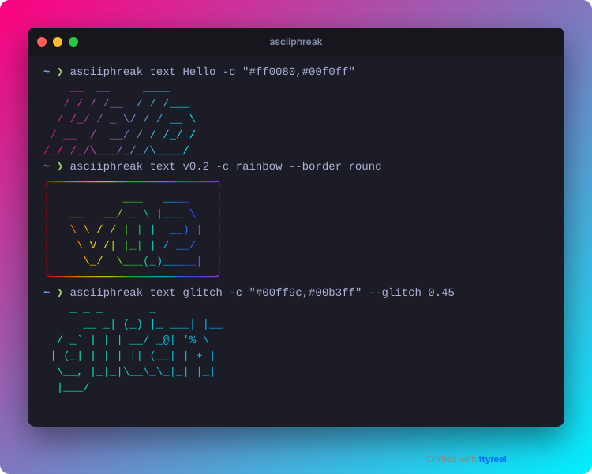

# 🎨 ASCIIForge: ASCII Art & Terminal Banner Studio

[](LICENSE)
[](https://buy.polar.sh/polar_cl_bicrfkUYm0tKq6steUcsbooPO6v02OBbe96lA4WqqSS)
[](https://github.com/aeon022)



*Made with ASCIIForge and [TermCast](https://github.com/aeon022/TermCast).*

```text
    ___   _____ ____________________                    
   /   | / ___// ____/  _/  _/ ____/___  _________ ____ 
  / /| | \__ \/ /    / / / // /_  / __ \/ ___/ __ `/ _ \
 / ___ |___/ / /____/ /_/ // __/ / /_/ / /  / /_/ /  __/
/_/  |_/____/\____/___/___/_/    \____/_/   \__, /\___/ 
                                           /____/       
```

**ASCIIForge** is a lightweight CLI tool engineered by **abteilung83**. It converts text strings and headers into stunning **ASCII art banners**, **ANSI-colored terminal text**, and **formatted code comment blocks** for TypeScript, Python, HTML, Rust, and C++ source files.

---

## ✨ Features

- 🔤 **300+ ASCII Fonts**: Powered by FIGlet's full bundled font library — includes popular picks like `Slant`, `Standard`, `Block`, `ANSI Shadow`, `3D-ASCII`, `Star Wars`, and hundreds more (run `ascii-forge fonts` for the full list).
- 🌈 **8 ANSI Color Presets**: `neon`, `fire`, `cyan`, `magenta`, `green`, `yellow`, `red`, `plain`.
- 💬 **Code Comment Block Generator**: Wraps ASCII banners in valid comments for 25+ languages (`/* … */`, `#`, `--`, `<!-- … -->`); sequences that could close the comment early are neutralised.
- 🚀 **Pure JS, No Native Dependencies**: No compiled/native modules to install — blazing fast rendering in under 10 milliseconds.
- 🔑 **Polar.sh Pro License**: Support the project via Polar and remove the watermark from generated comment blocks.

---

## 🚀 Quickstart & Tutorial

### 1. Installation
Install straight from GitHub (needs Node 18+; the package builds itself on install):

```bash
npm install -g github:aeon022/ASCIIForge
# or run once without installing:
npx github:aeon022/ASCIIForge text "Hello"
```

### 2. Generate ASCII Text Banner
Generate a colored ASCII banner in your terminal:

```bash
ascii-forge text "Hello" --font slant --color neon

# the banner is the only thing on stdout, so this works:
ascii-forge text "Hello" --color plain > banner.txt
```

### 3. Generate Formatted Code Comments
Generate ASCII section headers directly formatted as code comments:

```bash
ascii-forge comment "SYNC ENGINE" --language typescript >> src/sync.ts
```

Output (the watermark line is removed by a Pro licence):
```typescript
/*
 *    _______  ___   ________   _______   _____________   ________
 *   / ___/\ \/ / | / / ____/  / ____/ | / / ____/  _/ | / / ____/
 *   \__ \  \  /  |/ / /      / __/ /  |/ / / __ / //  |/ / __/
 *  ___/ /  / / /|  / /___   / /___/ /|  / /_/ // // /|  / /___
 * /____/  /_/_/ |_/\____/  /_____/_/ |_/\____/___/_/ |_/_____/
 * [Crafted with ASCIIForge by abteilung83]
 */
```

`--language` (`-L`) knows TypeScript/JavaScript, C, C++, C#, Java, Go, Rust, Swift, Kotlin, PHP, CSS/SCSS (block comments), Python, shell, YAML, Ruby, TOML, Dockerfile (`#`), SQL, Lua (`--`), HTML, Markdown and XML. Run `ascii-forge languages` for the list with aliases (`ts`, `py`, `sh`, `yml` …). The art is made safe for the language: a `*` followed by `/` or `-->` inside the art cannot close the comment early.

### 4. Find a font
```bash
ascii-forge fonts          # all of them
ascii-forge fonts shadow   # only names containing "shadow"
```

A misspelled font is an error with a suggestion (`Did you mean "Slant"?`), not a silent different font. The licence status and the Pro hint go to stderr, so redirecting stdout always gives you just the art. Errors exit with code 1.

---

## 💜 Pro License & Support

Support further development and remove comment watermarks!

👉 **[Support & Unlock Pro on Polar](https://buy.polar.sh/polar_cl_bicrfkUYm0tKq6steUcsbooPO6v02OBbe96lA4WqqSS)**

---

## 🏢 About abteilung83

**ASCIIForge** is engineered and maintained by **abteilung83** — specializing in developer tools, CLI utilities, workflow automation, and open-source integrations.

- **GitHub**: [@aeon022](https://github.com/aeon022)

---

## 📄 License

Distributed under the MIT License. See `LICENSE` for details.
