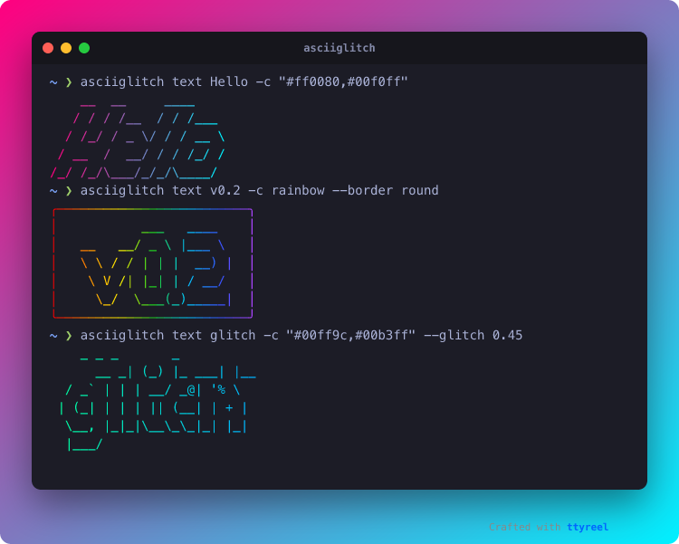

# 🎨 asciiglitch: ASCII art for hackers, READMEs and source files

[](LICENSE)
[](https://buy.polar.sh/polar_cl_bicrfkUYm0tKq6steUcsbooPO6v02OBbe96lA4WqqSS)
[](https://github.com/aeon022)



*Made with asciiglitch and [ttyreel](https://github.com/aeon022/ttyreel) (`ttyreel play docs/demo.yml`).*

```text
                   _ _       ___ __       __
  ____ ___________(_|_)___ _/ (_) /______/ /_
 / __ `/ ___/ ___/ / / __ `/ / / __/ ___/ __ \
/ /_/ (__  ) /__/ / / /_/ / / / /_/ /__/ / / /
\__,_/____/\___/_/_/\__, /_/_/\__/\___/_/ /_/
                   /____/
```

**asciiglitch** is a CLI tool by **abteilung83**. It turns text into **ASCII art**, **ANSI-colored terminal text**, and **formatted code comment blocks** for TypeScript, Python, HTML, Rust, and C++ source files.

*asciiglitch was called ASCIIForge before 0.2.0; the name was taken by an unrelated app.*

---

## ✨ Features

- 🔤 **328 FIGlet fonts**, with `-f random`, a preview (`fonts shadow --preview "Hi"`) and typo suggestions.
- 🌈 **Colours and gradients:** presets (`neon`, `fire`, `rainbow`, `cyan` …), a hex colour, or a gradient across any number of colours (`-c "#ff0080,#00f0ff"`), horizontal, vertical or diagonal. `NO_COLOR` is respected.
- ⚡ **Glitch effect:** `--glitch 0.3` shifts rows and breaks characters like a failing screen; `--seed 7` makes it repeatable.
- 📐 **Layout:** `--border single|double|round|bold|ascii`, `--align center|right`, `--width` (wraps the text), `--layout full|fitted|smush` (letter spacing).
- 💬 **Comment blocks for 25+ languages**, safe against sequences that would close the comment early. `--insert file.py --tag hero` puts the block into a file and updates it on the next run instead of adding another.
- 🚀 **Start-up snippets** (`snippet`): code that prints your banner when an app starts (JS, TS, Python, Go, Rust, shell).
- 🖥️ **Login banners** (`motd`): banner plus host, system and uptime.
- 💾 **Files:** `-o banner.svg` / `.html` keep the colours, `.md` wraps it in a code block, anything else is plain text. `--copy` puts it on the clipboard.
- ⚙️ **Defaults per project or user** in `.asciiglitchrc.json` (`asciiglitch init`).
- 🧪 **Pipe-friendly:** the banner is the only thing on stdout, text can be piped in, errors exit with code 1.
- 🔑 **Polar.sh Pro:** support the project and remove the watermark from generated comment blocks.

---

## 🚀 Quickstart

### 1. Installation
Needs Node 18+. Try it without installing:

```bash
npx github:aeon022/asciiglitch text "Hello"
```

Install it (keep the cloned folder: the global command links to it):

```bash
git clone https://github.com/aeon022/asciiglitch.git
cd asciiglitch
npm install --omit=dev
npm install -g .
```

### 2. Text banners
```bash
asciiglitch text "Hello"                                      # neon, Slant
asciiglitch text "Hello" -f "ANSI Shadow" -c "#ff0080,#00f0ff"  # gradient
asciiglitch text "v1.0" -c rainbow --border round --align center --width 60
echo "Release day" | asciiglitch text -c fire                 # from a pipe
asciiglitch text "Hello" -c plain > banner.txt                # stdout is only the art
asciiglitch text "Hello" -c "#ff0080,#00f0ff" -o banner.svg   # coloured SVG
asciiglitch text "Hello" --copy                               # clipboard
asciiglitch text "SYSTEM FAILURE" -c fire --glitch 0.5 --seed 7  # glitch effect
```

### 3. Code comments
```bash
asciiglitch comment "SYNC ENGINE" -L typescript >> src/sync.ts       # print / append
asciiglitch comment "SYNC ENGINE" --insert src/sync.ts --tag hero    # put it in, update on re-run
asciiglitch comment "DATA PIPELINE" --insert pipeline.py --at 3      # at line 3 (language from the extension)
```

Output (the watermark line is removed by a Pro licence):
```typescript
/*
 *    _______  ___   ________   _______   _____________   ________
 *   / ___/\ \/ / | / / ____/  / ____/ | / / ____/  _/ | / / ____/
 *   \__ \  \  /  |/ / /      / __/ /  |/ / / __ / //  |/ / __/
 *  ___/ /  / / /|  / /___   / /___/ /|  / /_/ // // /|  / /___
 * /____/  /_/_/ |_/\____/  /_____/_/ |_/\____/___/_/ |_/_____/
 * [Crafted with asciiglitch by abteilung83]
 */
```

`--language` (`-L`) knows TypeScript/JavaScript, C, C++, C#, Java, Go, Rust, Swift, Kotlin, PHP, CSS/SCSS (block comments), Python, shell, YAML, Ruby, TOML, Dockerfile (`#`), SQL, Lua (`--`), HTML, Markdown and XML; `asciiglitch languages` lists them with aliases (`ts`, `py`, `sh`, `yml` …). With `--tag`, the block sits between `asciiglitch:begin NAME` and `asciiglitch:end NAME` comment lines; do not edit between them. A `#!` line stays first.

### 4. Start-up banner and login banner
```bash
asciiglitch snippet "MyApp" -L python     # prints code that shows the banner when your app starts
asciiglitch motd "my-server"              # banner + host · OS · uptime, for ~/.bashrc or /etc/motd
```

### 5. Fonts
```bash
asciiglitch fonts                          # all of them
asciiglitch fonts shadow --preview "Hi"    # draw each font whose name contains "shadow"
asciiglitch text "Hi" -f random            # surprise me
```
A misspelled font is an error with a suggestion (`Did you mean "Slant"?`), not a silent different font.

### 6. Project defaults
```bash
asciiglitch init      # writes .asciiglitchrc.json
```
```json
{ "font": "Slant", "color": "neon", "language": "typescript", "align": "left", "border": "none", "pad": 1 }
```
Settings are read from `~/.config/asciiglitch/defaults.json`, then from the nearest `.asciiglitchrc.json` up the folder tree; flags win. A typo in the file is an error that names it.

---

## 💜 Pro License & Support

Support further development and remove comment watermarks!

👉 **[Support & Unlock Pro on Polar](https://buy.polar.sh/polar_cl_bicrfkUYm0tKq6steUcsbooPO6v02OBbe96lA4WqqSS)**

---

## 🏢 About abteilung83

**asciiglitch** is engineered and maintained by **abteilung83** — specializing in developer tools, CLI utilities, workflow automation, and open-source integrations.

- **GitHub**: [@aeon022](https://github.com/aeon022)

---

## 📄 License

Distributed under the MIT License. See `LICENSE` for details.
